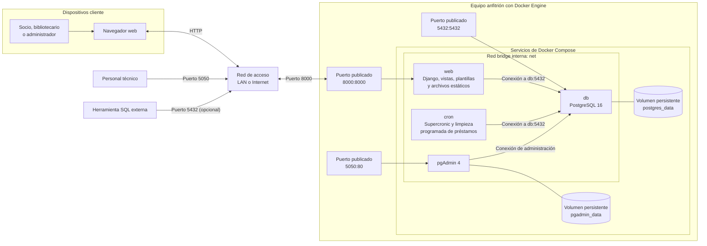

# Arquitectura física

El diagrama representa el despliegue definido en `liber/docker-compose.yml`. El equipo anfitrión se muestra de forma genérica porque el proyecto no fija sus características físicas (procesador, memoria, sistema operativo o ubicación). Los contenedores comparten los recursos de ese equipo.

La aplicación web y la tarea programada se ejecutan en contenedores distintos, pero usan la misma imagen del backend y se comunican con PostgreSQL a través de la red `net`. PostgreSQL conserva los datos en `postgres_data`; pgAdmin conserva su configuración en `pgadmin_data`. El navegador recibe páginas generadas por Django, por lo que no hay un contenedor de frontend independiente.

Los puertos publicados y la red de acceso representan la configuración de Compose; el repositorio no especifica si el servidor se encuentra en una red local o es accesible desde Internet, ni configura en Compose un proxy inverso o terminación TLS.
