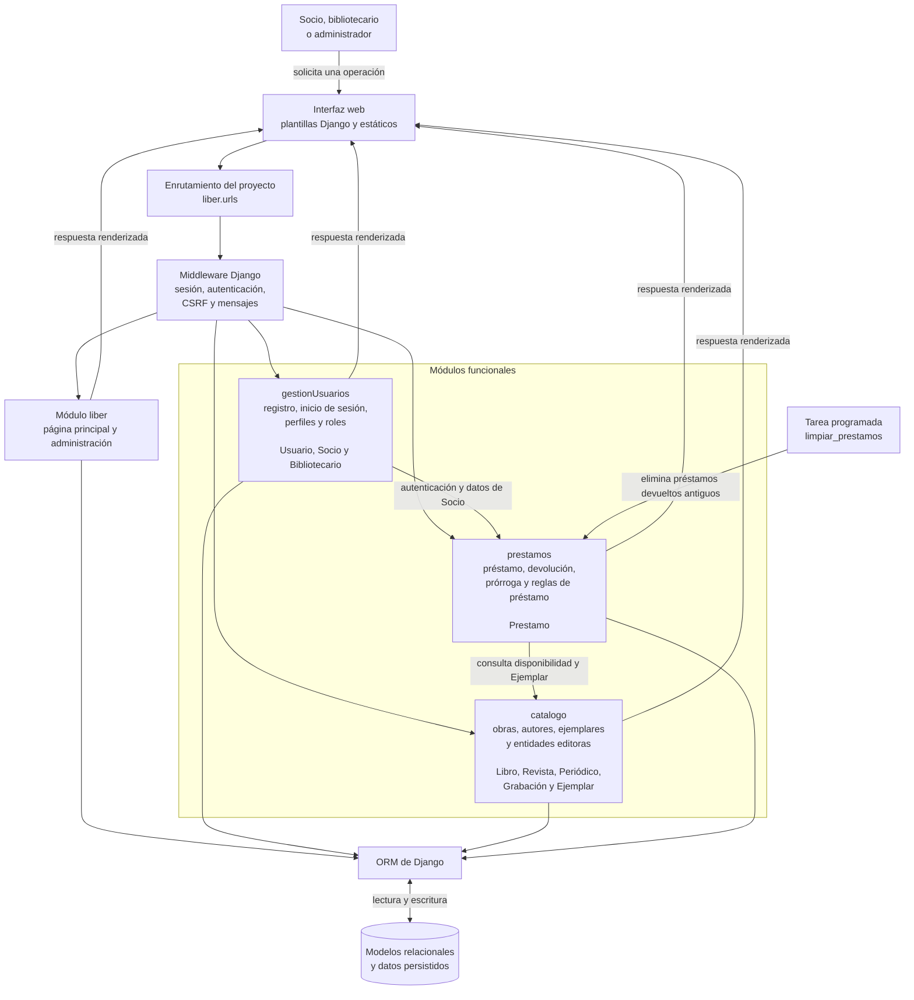

# Arquitectura lógica

Este diagrama describe las responsabilidades y dependencias entre los módulos de Liber, sin representar equipos, contenedores ni redes.

Una petición llega al enrutador del proyecto y pasa por los middlewares comunes de Django. A partir de la URL se ejecuta una vista del módulo correspondiente. Las vistas coordinan formularios, permisos y reglas de negocio, y acceden a los modelos mediante el ORM; después devuelven una página renderizada al navegador.

`gestionUsuarios` proporciona la identidad y los perfiles de socio o bibliotecario. `catalogo` gestiona las obras y sus ejemplares. `prestamos` usa los datos del socio y del ejemplar para aplicar las operaciones y restricciones de circulación. La tarea programada ejecuta el comando de limpieza de préstamos devueltos antiguos y persiste sus cambios usando las mismas reglas y modelos.
